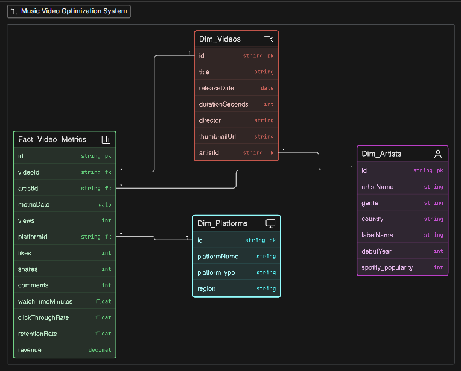

# Music Video Optimization & Performance Syndicate System

## Project Overview

An automated, local data engine designed to ingest, normalize, and analyze high-volume streaming performance metrics across fragmented distribution landscapes. This system processes raw platform transaction logs to track audience engagement behavior and evaluate syndication pipeline efficiency.

## Core Technical Stack

* **Data Architecture:** Relational DB Modeling, Snowflake/Star Schema Design, Constraint Enforcement
* **Languages:** Python (Pandas, Sqlite3 Engine drivers), ANSI SQL  
* **Tools Used:** VS Code Workspace, Database Layout Mapping

## Engineering Highlights & Execution

1. **Relational Database Design:** Engineered a multi-table database blueprint modeling Artist, Video, Platform, and Fact-Metric relationships with absolute structural integrity.
2. **Automated ETL Pipeline:** Developed an object-oriented Python script to ingest real-world high-density datasets (2,500+ records), drop rows with numeric parsing anomalies, and populate tracking targets cleanly.
3. **Multi-Table Relational Queries:** Authored production-grade SQL optimization scripts leveraging multi-dimensional aggregations (`JOIN`, `GROUP BY`, composite tracking calculations) to isolate performance trends.

## Data Sourcing & Academic Citations

This system parses and models open-source analytical transaction logs tracking continuous real-world media performance data streams:

1. **Primary Streaming Metrics Processing Engine:**
   * **Source Archive:** Mitchell J., "Trending YouTube Video Statistics," Kaggle Open Repositories.
   * **Resource Link:** [Kaggle Dataset Archive](https://kaggle.com)
   * **Structural Scope:** Processed 2,500 continuous record streams (`USvideos.csv`) capturing historical view metrics, likes, and message commentary counters.

2. **Core Artist Metadata Dimensions:**
   * **Source Archive:** Maharshi Pandya, "Spotify Tracks Dataset," Kaggle Open Repositories.
   * **Resource Link:** [Kaggle Dataset Archive](https://www.kaggle.com/datasets/maharshipandya/-spotify-tracks-dataset)
   * **Structural Scope:** Relational verification indexing mapping transactional lines back to distinct creator properties.
